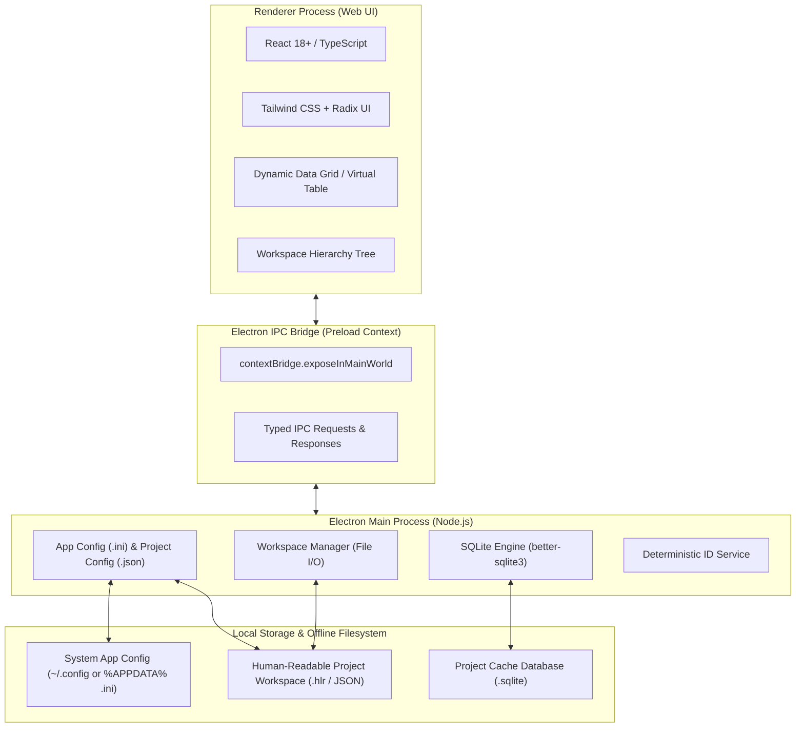

# Agents.md: High-Level Requirement (HLR) Writing Tool

> **Multiuser update (2026-10-17):** This document defines the offline authoring domain. Collaboration follows `docs/collab/BRIEF.md`, `ARCHITECTURE-v2.md`, `PERMISSIONS.md` and `PROTOCOL.md`. The optional headless server uses PostgreSQL, ordered operations and session edit locks; the desktop preserves local JSON/SQLite offline mode. See `docs/collab/DEPLOYMENT.md` for offline server installation, TLS trust, revisions and backups. The user explicitly authorized completing all remaining collaboration tasks in this session, superseding the old one-task-per-session instruction.


> **Context for AI Agents & Developers**  
> This document is the single source of truth for the architecture, domain model, user experience, data persistence, and engineering roadmap of the **HLR Writing Tool**. Any autonomous or semi-autonomous AI agent continuing this project must read, align with, and adhere strictly to the conventions and guidelines established here.

---

## 1. Project Overview & Mission

The **HLR Writing Tool** is a high-reliability, desktop-based requirements authoring and systems engineering application designed for mission-critical software, aerospace, automotive, and embedded engineering workflows (e.g., DO-178C, ISO 26262, IEC 61508 style requirement decompositions).

### Core Values
1. **Air-Gapped & Offline-First**: Must be 100% functional without an internet connection. Both development environment dependencies and binary builds must be installable and runnable on air-gapped Linux and Windows systems.
2. **Deterministic, Immutable ID Lifecycle**: Requirement and object IDs follow strict hierarchical prefixing and must never change, re-index, or shift when items are deleted.
3. **Transparent & Human-Readable Persistence**: Workspaces are saved in structured, human-readable files (JSON/YAML) so external tooling, diff viewers, version control systems (Git), and custom data converters can manipulate project data effortlessly.
4. **Offline Local Mode**: No external database server is needed for offline work. Optional multiuser collaboration uses a self-hosted PostgreSQL-backed server. Fast querying and relationship caching powered by an embedded SQLite engine.
5. **Configurable Schema**: Custom fields/columns for Requirements, Data Dictionaries, Entities, and Actions are configured project-wide.

### 1.1 Ground Truth: Original Product Owner Seed Prompt
> [!TIP]
> **Reference for Future Agents**: When resolving ambiguities or fine-tuning UX/architecture trade-offs, treat the following original user prompt as the definitive statement of intent:
>
> ```text
> This is a project requirement writing tool.
> The tool is going to be developed as a standalone desktop application that is
> developed with web technologies. electron is a good option. Both the
> development environment and the final build must include everything for
> deploying into an offline machine for both windows and linux. Databases must be
> serverless such as sqlite--- The project is all about creating requirements. You first
> create a project. the project workspace can be saved and later be loaded. The save
> format must be human readable so that I can write later data converters. You specify a
> prefix to be used for project-wide. Ours is GS- for example. ID of every requirement in
> the project will start with this REQ-GS-. There will 4 kind of objects. Requirements
> (must), Data Dictionary, Entity and Action. Each one will have a different prefix and
> the prefix and whether or not the prefix will be used can be specified from the
> settings. by default requirement->REQ, data dictionary item->DI, Entity->ENTT,
> action->ACT. --- In the requirements section, user will create modules as folders. Every
> module will has its own prefix. For example, compiler COMPL so the requirements under
> this will look like REQ-GS-COMPL. Btw casing rule such as all capital, all lower,
> mixed(as is) for requirement ids will be configured from the settings. Modules can have
> submoduled. The naming rule applies to them. Prefixes will be concatinated from parent
> to child. But modules can be configured for not having a prefix. The project settings
> will be stored in the project. THe application settings will be stored in system config
> directory as .ini file. The module creation will be under object type. Modules will be child 
> of the object type, for example -> [Requirements->Compiler->Parser->tsCreateParser->REQ-GS-TSCRTPRSR-001].
> Fİnally you create a function and function not looks like a folder. It is the final group of requirements. 
> When you create one you define a prefix for it and a name. Name must be unique under the same module.
> The main panel has a field for writing a description. Then you start adding requirements. Every requirement start with
> end-fix 001 and increments. Requirement ids never change even if you remove a requirement in the middle.
> What fields will the requirement file have is configured project wide. The columns are configured in the project settings. The same is valid for other object types.
> ```

---

## 2. Technology Stack & Deployment Architecture



### 2.1 Core Stack
- **Application Shell**: [Electron](https://www.electronjs.org/) (latest LTS), configured with `contextIsolation: true`, `sandbox: true`, and strict Content Security Policy (`script-src 'self'`).
- **Frontend / Renderer**: TypeScript + React 18+ (bundled via [Vite](https://vitejs.dev/)).
- **Styling & UI Components**: Tailwind CSS, Radix UI / Lucide icons (customized for high-density desktop productivity).
- **Embedded Database**: Serverless SQLite via `better-sqlite3` in the main process (used for fast cross-object indexing, full-text search, traceability querying, and referential validation).
- **Configuration Parsers**:
  - `ini` library for system-wide configuration.
  - Native JSON with schema validation (`zod`) for project-level configurations.

### 2.2 Offline & Air-Gapped Packaging Requirements
1. **Target Platforms**:
   - **Linux**: AppImage (portable, no external system dependencies) and `.deb`.
   - **Windows**: Portable `.exe` (zero installation footprint) and NSIS offline installer.
2. **Zero Runtime Network Dependency**:
   - All fonts (e.g., Inter, JetBrains Mono), stylesheets, icons, and vendor assets must be locally bundled inside the renderer distribution.
   - External CDN requests (`https://...`) are forbidden by strict CSP.
3. **Offline Development Toolchain**:
   - Maintain an `offline/` bundle script (e.g., `npm-pack-all` or offline vendor archive) containing all `node_modules` pre-cached or vendored so the application can be built from source on a machine without WAN access.
   - Pre-compiled binaries for `better-sqlite3` targeting both Linux (`glibc`) and Windows (`x64`) must be maintained in the build pipeline (`electron-rebuild` offline strategy).

---

## 3. Configuration Architecture

The application strictly separates **Global Application Settings** from **Project Workspace Settings**.

```
+-----------------------------------------------------------------------+
| SYSTEM CONFIG (Host OS)                                               |
| Path: System Config Directory (e.g., ~/.config/hlr-tool/config.ini)   |
| Format: .ini format                                                   |
| Scope: Theme, window geometry, recent projects, keybindings, language |
+-----------------------------------------------------------------------+
                                  |
                                  v
+-----------------------------------------------------------------------+
| PROJECT CONFIG (Inside Workspace)                                     |
| Path: <workspace-root>/project.config.json                            |
| Format: Human-readable JSON                                           |
| Scope: Project prefix, ID casing, Object prefixes, Custom columns     |
+-----------------------------------------------------------------------+
```

### 3.1 Application Settings (`config.ini`)
Stored in the host OS standard configuration directory:
- **Linux**: `~/.config/hlr-writing-tool/config.ini` (or `$XDG_CONFIG_HOME/hlr-writing-tool/config.ini`)
- **Windows**: `%APPDATA%\hlr-writing-tool\config.ini`

**Schema Sample (`config.ini`)**:
```ini
[general]
theme = dark
language = en
auto_save_interval_sec = 300

[window]
width = 1440
height = 900
maximized = false

[recent_projects]
1 = /home/tahameg/Workspace/SampleProject
2 = /home/tahameg/Workspace/FlightControl
```

### 3.2 Project Settings (`project.config.json`)
Stored directly inside the root of each project workspace. Contains all rules governing object types, naming, prefixes, and table columns.

**Schema Sample (`project.config.json`)**:
```json
{
  "version": "1.0.0",
  "projectId": "PRJ-9912",
  "projectName": "Guidance System",
  "projectPrefix": "GS",
  "idCasing": "UPPER",
  "objectTypes": {
    "REQUIREMENT": {
      "name": "Requirements",
      "prefix": "REQ",
      "enabled": true,
      "usePrefix": true,
      "columns": [
        { "id": "col_desc", "name": "Description", "type": "markdown", "required": true, "system": true },
        { "id": "col_status", "name": "Status", "type": "enum", "options": ["Draft", "Reviewed", "Approved", "Obsolete"], "default": "Draft" },
        { "id": "col_verif", "name": "Verification Method", "type": "enum", "options": ["Test", "Analysis", "Inspection", "Demonstration"], "default": "Test" },
        { "id": "col_priority", "name": "Priority", "type": "enum", "options": ["Low", "Medium", "High", "Critical"], "default": "Medium" },
        { "id": "col_safety_class", "name": "Safety Class", "type": "string", "default": "DAL-A" },
        { "id": "col_notes", "name": "Rationale & Notes", "type": "text" }
      ]
    },
    "DATA_DICTIONARY": {
      "name": "Data Dictionary",
      "prefix": "DI",
      "enabled": true,
      "usePrefix": true,
      "columns": [
        { "id": "col_name", "name": "Identifier Name", "type": "string", "required": true },
        { "id": "col_data_type", "name": "Type", "type": "string", "default": "uint32_t" },
        { "id": "col_units", "name": "Units", "type": "string" },
        { "id": "col_range", "name": "Valid Range", "type": "string" },
        { "id": "col_desc", "name": "Description", "type": "text" }
      ]
    },
    "ENTITY": {
      "name": "Entity",
      "prefix": "ENTT",
      "enabled": true,
      "usePrefix": true,
      "columns": [
        { "id": "col_name", "name": "Entity Name", "type": "string", "required": true },
        { "id": "col_category", "name": "Category", "type": "string" },
        { "id": "col_desc", "name": "Description", "type": "text" }
      ]
    },
    "ACTION": {
      "name": "Action",
      "prefix": "ACT",
      "enabled": true,
      "usePrefix": true,
      "columns": [
        { "id": "col_name", "name": "Action Name", "type": "string", "required": true },
        { "id": "col_trigger", "name": "Trigger Condition", "type": "string" },
        { "id": "col_desc", "name": "Description", "type": "text" }
      ]
    }
  }
}
```

---

## 4. Domain Hierarchy & Data Model

The application organizes all engineering items into a strict tree hierarchy rooted in the 4 fundamental object types:

```
[Root: Object Type] (Requirements | Data Dictionary | Entity | Action)
  └── [Module: Folder] (e.g., Compiler [COMPL])
        ├── [Submodule: Folder] (e.g., Parser [PARSER])
        │     └── [Function: Leaf Group] (e.g., tsCreateParser [TSCRTPRSR])
        │           ├── Function Description: Markdown/Text
        │           └── Requirement Table:
        │                 ├── REQ-GS-COMPL-PARSER-TSCRTPRSR-001
        │                 ├── REQ-GS-COMPL-PARSER-TSCRTPRSR-002
        │                 └── REQ-GS-COMPL-PARSER-TSCRTPRSR-003
        └── [Module: Folder] (e.g., Optimizer [OPT])
              └── ...
```

### 4.1 Hierarchy Entities
1. **Object Type (Root)**:
   - Fixed 4 categories: `Requirements`, `Data Dictionary`, `Entity`, `Action`.
   - Cannot be deleted or renamed.
   - Settings can enable/disable usage of prefix and set the prefix string.
2. **Module (Folder)**:
   - Acts as a container/folder. Can have nested submodules to arbitrary depth.
   - Properties: `id`, `name`, `prefix` (optional), `description`, `parentId`.
   - If `prefix` is omitted or empty, this module does not contribute a prefix token to the child ID chain.
3. **Function (Leaf Requirement Group)**:
   - **Crucial Distinction**: The Function is the final grouping layer. It does **not** look or act like a folder in the UI (distinct icon, badge, and styling).
   - Functions cannot contain child modules or child functions.
   - Properties:
     - `id`: Internal UUID.
     - `name`: Human-readable name (must be **unique** within its immediate parent module).
     - `prefix`: Prefix code for the function (e.g., `tsCreateParser` -> `TSCRTPRSR`).
     - `description`: Main body/header text describing the function's scope, inputs, outputs, and design rationale.
     - `watermarkCounter`: Monotonically increasing integer tracking the highest requirement ID assigned (to ensure ID immutability).
4. **Requirement / Item (Leaf Row)**:
   - Stored in tabular form under a Function.
   - Properties:
     - `id`: Formatted, immutable identifier (e.g., `REQ-GS-COMPL-PARSER-TSCRTPRSR-001`).
     - `sequenceNumber`: Integer sequence (e.g., `1`).
     - Dynamic field values matching the columns configured for this Object Type.

---

## 5. ID Generation & Immutability Rules

Identifiers represent legal engineering contracts and must adhere to strict deterministic rules:

### 5.1 ID Composition Formula
$$\text{ID} = [\text{OBJECT\_TYPE\_PREFIX}] - [\text{PROJECT\_PREFIX}] - [\text{MODULE\_PREFIXES}\dots] - [\text{FUNCTION\_PREFIX}] - [\text{INDEX}]$$

- **Delimiter**: Hyphen (`-`).
- **Rules on Omission**:
  - If an Object Type has `usePrefix = false`, the `[OBJECT_TYPE_PREFIX]` is omitted.
  - If `PROJECT_PREFIX` is empty, it is omitted.
  - If a Module has an empty prefix, it is omitted from the chain without leaving double hyphens.
  - The `[INDEX]` is zero-padded to at least 3 digits (`001`, `002`, ..., `999`, `1000`).

### 5.2 Casing Transformations
Configured project-wide under `idCasing`:
- `UPPER`: Converts all tokens to uppercase (e.g., `REQ-GS-COMPL-PARSER-TSCRTPRSR-001`). **[Default]**
- `LOWER`: Converts all tokens to lowercase (e.g., `req-gs-compl-parser-tscrtprsr-001`).
- `AS_IS`: Retains exact casing entered by the user (e.g., `REQ-GS-Compl-Parser-tsCreateParser-001`).

### 5.3 ID Immutability (Non-Renumbering Guarantee)
- When a requirement is deleted (e.g., deleting `002` from a list of `001`, `002`, `003`), remaining requirements are **never renumbered**. The list remains `001`, `003`.
- The next requirement created must receive index `004`.
- **Implementation Mechanism**:
  - Each Function maintains a persistent `watermarkCounter` in its metadata.
  - Allocation formula: `nextIndex = watermarkCounter + 1; watermarkCounter = nextIndex;`
  - Rebuilding or importing checks `max(existing_ids)` to prevent collisions.

---

## 6. Persistence & File System Layout

To enable easy conversion by external tools, the project directory format is human-readable, split by domain, and git-friendly.

### 6.1 Workspace Directory Structure
```
MyProject.hlr/
├── project.config.json              <-- Project settings & column definitions
├── .hlr/
│   └── cache.sqlite                 <-- SQLite runtime index (reconstructible cache)
├── requirements/
│   ├── modules.json                 <-- Module tree structure for Requirements
│   └── functions/
│       ├── fn-tsCreateParser.json   <-- Function metadata, description & requirements
│       └── fn-tsParseAST.json
├── data-dictionary/
│   ├── modules.json
│   └── functions/
├── entities/
│   ├── modules.json
│   └── functions/
└── actions/
    ├── modules.json
    └── functions/
```

### 6.2 Function & Requirement File Schema (`fn-*.json`)
```json
{
  "functionId": "fn_f48b11a9-b2de-4f11-9a7c-31a89c9d5e30",
  "name": "tsCreateParser",
  "prefix": "TSCRTPRSR",
  "modulePath": ["Compiler", "Parser"],
  "parentModuleId": "mod_b819f0a2",
  "description": "# tsCreateParser Specification\nInitializes the lexical and syntax parser with the supplied configuration.\n\n### Inputs\n- `config`: ParserConfiguration\n### Outputs\n- `parserInstance`: Handle",
  "watermarkCounter": 3,
  "items": [
    {
      "id": "REQ-GS-COMPL-PARSER-TSCRTPRSR-001",
      "seq": 1,
      "created_at": "2026-09-25T05:50:00Z",
      "values": {
        "col_desc": "The parser shall allocate an AST memory arena of at least 64KB upon initialization.",
        "col_status": "Approved",
        "col_verif": "Test",
        "col_priority": "Critical",
        "col_safety_class": "DAL-A",
        "col_notes": "Derived from memory budget specification section 4.2."
      }
    },
    {
      "id": "REQ-GS-COMPL-PARSER-TSCRTPRSR-003",
      "seq": 3,
      "created_at": "2026-09-25T05:52:10Z",
      "values": {
        "col_desc": "If memory allocation fails, the parser shall emit an ERR_NOMEM error code and return a NULL handle.",
        "col_status": "Draft",
        "col_verif": "Test",
        "col_priority": "High",
        "col_safety_class": "DAL-A",
        "col_notes": "Safety fail-stop requirement."
      }
    }
  ]
}
```

> [!NOTE]  
> Notice in the example above that requirement `002` was deleted. The file preserves `001` and `003`, while `watermarkCounter: 3` guarantees that the next requirement created will be `004`.

---

## 7. UI / UX Design Specifications

The application uses an ergonomic 3-pane layout designed for dense engineering productivity:

```
+----------------------------------------------------------------------------------------------------+
| Top Bar: Project Name [GS-Guidance System] | Breadcrumbs: Requirements > Compiler > Parser > tsCreateParser | Save [Ctrl+S] | Settings |
+-----------------------+----------------------------------------------------------------------------+
| WORKSPACE EXPLORER    | MAIN EDITOR PANEL: Function View                                          |
|                       |                                                                            |
| [Search tree...     ] | Function: tsCreateParser          Prefix: [TSCRTPRSR]                      |
|                       | Parent Module: Compiler / Parser                                           |
| > Requirements        +----------------------------------------------------------------------------+
|   v Compiler [COMPL]  | Description: (Markdown / Rich-Text Editor)                                 |
|     v Parser [PARSER] |   The parser shall initialize an AST arena and validate tokens...         |
|       * tsCreateParser+----------------------------------------------------------------------------+
|       * tsParseAST    | Requirements Table                       [+ Add Requirement] [Export CSV]  |
|     > Lexer [LEX]     | +------------------------------------------------------------------------+ |
|   > CodeGen [CODEGEN] | | ID               | Description                  | Status   | Verif   | ... | |
| > Data Dictionary     | |------------------+------------------------------+----------+---------+-----| |
| > Entity              | | REQ-GS-...-001   | Allocate 64KB AST memory...  | Approved | Test    | ... | |
| > Action              | | REQ-GS-...-003   | Emit ERR_NOMEM on failure... | Draft    | Test    | ... | |
|                       | +------------------------------------------------------------------------+ |
+-----------------------+----------------------------------------------------------------------------+
| Status Bar: Items: 1,420 | SQLite Index: OK | Air-Gapped Ready | Workspace: /home/.../MyProject.hlr  |
+----------------------------------------------------------------------------------------------------+
```

### 7.1 Left Sidebar (Navigation Tree)
- Top-level roots: The 4 Object Types (Requirements, Data Dictionary, Entity, Action).
- Folders: Modules and submodules (expandable/collapsible). Right-click context menu: `Add Submodule`, `Add Function`, `Rename`, `Delete`, `Properties (Prefix)`.
- Leaves: Functions. Displayed with a distinct icon (e.g., function badge `fx` or document icon), never a folder icon.
- Filter/Search: Instant filter by ID, Name, or Prefix.

### 7.2 Main Editor Panel
When a Function is selected in the tree:
1. **Header Zone**:
   - Function Name & Prefix inputs (editable with uniqueness validation).
   - Module path breadcrumbs.
   - Live ID preview sample: shows how requirements in this function will be formatted.
2. **Function Description Zone**:
   - Collapsible markdown editor with live preview toggle.
   - Documents high-level specification, function parameters, inputs, outputs, and design constraints.
3. **Requirement Data Grid**:
   - Virtualized table displaying all requirements under this function.
   - Columns are rendered dynamically based on `project.config.json`.
   - Direct inline cell editing (text input, select dropdowns, date pickers).
   - `Add Requirement` button: immediately appends a row with the next sequence ID.
   - Row deletion: prompt for confirmation; ID is permanently retired (tombstoned).

### 7.3 Settings Modals
1. **Project Settings Modal**:
   - Configure `projectPrefix` (e.g., `GS`).
   - Configure `idCasing` (`UPPER`, `LOWER`, `AS_IS`).
   - Configure Object Types: Toggle prefixes, change prefix labels (`REQ`, `DI`, `ENTT`, `ACT`).
   - **Column Designer**: Add/remove/reorder columns for each object type (Text, Dropdown Options, Default values).
2. **Application Settings Modal**:
   - Theme toggle (Dark / Light / High Contrast).
   - Auto-save timer.
   - Storage locations and default export folders.

---

## 8. Database & Search Engine (SQLite Architecture)

While human-readable files represent the durable source of truth, an embedded SQLite database (`.hlr/cache.sqlite`) is maintained for lightning-fast application operations.

### 8.1 SQLite Schema
```sql
CREATE TABLE IF NOT EXISTS modules (
    id TEXT PRIMARY KEY,
    object_type TEXT NOT NULL,
    parent_id TEXT,
    name TEXT NOT NULL,
    prefix TEXT,
    sort_order INTEGER DEFAULT 0
);

CREATE TABLE IF NOT EXISTS functions (
    id TEXT PRIMARY KEY,
    module_id TEXT NOT NULL,
    name TEXT NOT NULL,
    prefix TEXT NOT NULL,
    description TEXT,
    watermark_counter INTEGER DEFAULT 0,
    FOREIGN KEY(module_id) REFERENCES modules(id) ON DELETE CASCADE
);

CREATE TABLE IF NOT EXISTS items (
    id TEXT PRIMARY KEY,               -- e.g. REQ-GS-COMPL-PARSER-TSCRTPRSR-001
    function_id TEXT NOT NULL,
    sequence_num INTEGER NOT NULL,
    object_type TEXT NOT NULL,
    values_json TEXT NOT NULL,         -- JSON object of dynamic column values
    created_at TEXT NOT NULL,
    updated_at TEXT NOT NULL,
    FOREIGN KEY(function_id) REFERENCES functions(id) ON DELETE CASCADE
);

-- Full-Text Search (FTS5) for instant lookup
CREATE VIRTUAL TABLE IF NOT EXISTS items_fts USING fts5(
    id,
    function_name,
    description,
    values_text
);
```

### 8.2 Synchronization Protocol
- When opening a project, the engine parses `project.config.json` and JSON files under `requirements/`, `data-dictionary/`, etc., populating the SQLite cache.
- Any change in the UI writes through to the respective `fn-*.json` file and updates SQLite simultaneously.
- If `.hlr/cache.sqlite` is missing or corrupted, it is automatically re-indexed from the human-readable JSON files upon project load.

---

## 9. Project Directory Structure

```
hlr-writing-tool/
├── package.json
├── electron-builder.yml            <-- Packaging config (AppImage, deb, win-portable, nsis)
├── tsconfig.json
├── vite.config.ts
├── offline/                         <-- Offline scripts and dependency cache
│   ├── download-deps.sh            <-- Pre-fetches npm tarballs and sqlite prebuilds
│   └── package-offline-bundle.sh
├── src/
│   ├── main/                       <-- Electron Main Process
│   │   ├── index.ts                <-- Main entrypoint & lifecycle
│   │   ├── config/
│   │   │   ├── appConfig.ts        <-- INI file manager (~/.config/hlr-tool/config.ini)
│   │   │   └── projectConfig.ts    <-- Project settings manager (project.config.json)
│   │   ├── db/
│   │   │   ├── sqliteClient.ts     <-- better-sqlite3 wrapper & queries
│   │   │   └── migrations.ts       <-- Schema creation & indexing
│   │   ├── services/
│   │   │   ├── idGenerator.ts      <-- Deterministic ID and casing calculation
│   │   │   ├── workspaceService.ts <-- JSON reader/writer, save, load, export
│   │   │   └── searchService.ts    <-- FTS5 search queries
│   │   └── ipc/
│   │       └── registerHandlers.ts <-- Typed IPC handlers
│   ├── preload/                    <-- Electron Preload Bridge
│   │   ├── index.ts                <-- contextBridge API definition
│   │   └── api.d.ts                <-- Shared IPC TypeScript interfaces
│   ├── renderer/                   <-- Frontend Web UI (React + TS)
│   │   ├── index.html
│   │   ├── main.tsx
│   │   ├── App.tsx
│   │   ├── assets/                 <-- Bundled offline fonts, icons
│   │   ├── components/
│   │   │   ├── layout/             <-- Sidebar, Header, Statusbar
│   │   │   ├── tree/               <-- Modules & Functions Tree Explorer
│   │   │   ├── editor/             <-- Function description & Requirement Table
│   │   │   ├── grid/               <-- Virtualized dynamic column table
│   │   │   └── settings/           <-- App Settings & Project Settings Modals
│   │   ├── context/                <-- React State & Workspace Stores
│   │   └── styles/
│   └── shared/                     <-- Code shared across Main, Preload, and Renderer
│       ├── types/
│       │   ├── config.ts
│       │   ├── schema.ts
│       │   └── workspace.ts
│       └── utils/
│           └── idUtils.ts          <-- Pure functions for ID formatting
└── tests/
    ├── unit/
    │   ├── idGenerator.test.ts
    │   └── config.test.ts
    └── e2e/
```

---

## 10. Phased Implementation Roadmap

Every AI agent working on this repository should locate the active phase and proceed sequentially:

| Phase | Milestone | Scope & Deliverables | Verification Criteria |
| :--- | :--- | :--- | :--- |
| **Phase 1** | **Foundations & Core Domain Engine** | - Pure TypeScript domain models (`shared/types`).<br>- Deterministic ID generator with casing rules and watermark tracking.<br>- Human-readable JSON Workspace format & file I/O layer.<br>- Unit tests for ID generation, immutability, and JSON load/save. | `npm test` passes with 100% coverage on ID calculation, non-renumbering logic, and schema validation. |
| **Phase 2** | **App Shell, Config & Offline Engine** | - Electron main/preload setup with Vite.<br>- System INI configuration manager (`appConfig.ts`).<br>- Project configuration manager (`projectConfig.ts`).<br>- Offline SQLite integration (`better-sqlite3`). | App launches in standalone offline mode. INI file is created in OS config directory. SQLite connects locally. |
| **Phase 3** | **Workspace Explorer & Hierarchy Tree** | - Left navigation tree for 4 Object Types.<br>- Module (folder) creation, nesting, renaming, prefixing.<br>- Function creation (unique name check, prefix, non-folder icon).<br>- Breadcrumb navigation. | User can build multi-level modules and functions under any of the 4 object types with proper prefix cascade. |
| **Phase 4** | **Function View & Dynamic Grid Editor** | - Markdown description editor for Functions.<br>- Dynamic column rendering based on project settings.<br>- Requirement table: inline editing, Add/Delete with immutable IDs.<br>- Project Settings Modal (column customizer, casing options). | Requirements can be added, edited, and deleted; IDs never re-index; custom columns reflect immediately. |
| **Phase 5** | **Offline Search & Cross-Object Linking** | - SQLite FTS5 search modal (`Ctrl+P` / `Ctrl+F`).<br>- Data Dictionary, Entity, and Action reference pickers inside requirement cells.<br>- Export to CSV/Markdown. | Instant search across 10,000+ requirements in under 50ms; links resolve accurately. |
| **Phase 6** | **Packaging & Air-Gapped Distribution** | - `electron-builder` configuration for Linux (AppImage) and Windows (portable exe).<br>- Offline dependency bundle script in `offline/`.<br>- E2E tests validating execution without network interface. | Build outputs runnable AppImage and Windows EXE with zero external asset requests. |

---

## 11. Agent Operating Instructions & Best Practices

1. **Strict ID Immutability**:
   - Never implement bulk ID re-indexing or auto-decrementing when a row is removed. Gaps in sequence numbers are intended behavior.
2. **Offline Integrity**:
   - Never introduce dependencies that fetch fonts, scripts, or stylesheets from CDNs.
   - Always verify that new npm packages do not rely on remote post-install binaries unless bundled offline.
3. **IPC Safety**:
   - Always route file system operations and SQLite queries through typed IPC handlers in `src/main/ipc`.
   - Never expose raw `fs` or `child_process` modules to the renderer process.
4. **Data Converter Compatibility**:
   - Keep `fn-*.json` and `modules.json` human-readable (use 2-space indentation).
   - Ensure the JSON schema is clean, self-describing, and free of internal UI-specific runtime ephemera.
5. **Code Style**:
   - Strict TypeScript (`"strict": true` in `tsconfig.json`).
   - Clean, decoupled modular design. Every major module must have an accompanying unit test.

---

## 12. Implementation Status (2026-09-25)

- **Phase 1 completed**: strict TypeScript domain models, Zod schemas and relational validation, immutable ID allocation/deletion, hierarchy factory helpers, JSON workspace save/load and interrupted-save replay.
- **Verification**: `npm run typecheck`, `npm test` (10 passing tests; 100% reported statement, branch, function and line coverage), and `npm run build` pass.
- **Format extension**: root `retired-ids.json` persists project-wide tombstones so prefix collisions cannot recycle deleted IDs. `.hlr/pending-save.json` is a transient recovery journal, separate from the future SQLite cache.
- **Phase 2 completed**: Electron/React/Vite shell with local-only assets, sandboxed bundled preload and validated IPC; workspace creation/open/recent/save flows; INI application settings; validated project settings; reconstructible SQLite/FTS5 cache.
- **Phase 2 verification**: strict type checking and renderer/main/preload builds pass; 16 unit tests pass, preserving 100% coverage thresholds on core ID and validation modules; a real Electron smoke test passes for sandboxing, offline CSP, creation/opening, settings persistence, native SQLite, save and reload.
- **Runtime detail**: SQLite is built for Electron's ABI. `npm test` uses Electron's Node mode to avoid incompatible system-Node native binaries. `npm run setup:desktop` is a connected preparation step, not an air-gapped packaging solution.
- **Phase 3 completed**: selectable object roots; expandable/filterable hierarchy; nested module and leaf-function creation; context actions; properties/rename/prefix editing; unique sibling function names; breadcrumbs; next-ID preview; confirmation for subtree deletion with ID retirement. Hierarchy changes save via validated typed IPC and rebuild the SQLite cache. Existing function items are displayed read-only.
- **Phase 3 verification**: strict TypeScript/build checks and 20 unit tests pass; both real-window desktop regression suites pass, including all four roots, nested groups, keyboard navigation, ID search, uniqueness validation, immutable IDs, properties, deletion cancellation/confirmation, and reopening. Screenshots were inspected.
- **Phase 4 completed**: windowed dynamic item grid with typed inline editors, validated pending rows, immutable saved IDs, confirmation for deletion, Markdown scope edit/preview, Ctrl+S, idle autosave and unsaved-edit protection; full project column designer with default migration and protected system columns.
- **Phase 5 completed**: SQLite FTS5 search dialog (Ctrl+P/Ctrl+F), typed cross-object reference columns/pickers/navigation and referential deletion checks, CSV/Markdown export via native dialogs. Unit benchmark over 10,000 items passed below 50 ms (observed approximately 0.6 ms on this host).
- **Phase 4/5 verification**: 25 unit tests pass; authoring, hierarchy and desktop real-window suites pass. Core ID/schema/validation modules retain enforced 100% coverage.
- **Phase 6 implementation**: electron-builder targets Linux AppImage/deb and Windows portable/NSIS; explicit native ABI manifests; offline source/dependency/Node/Electron bundle tooling; packaged smoke self-test. Linux packaged smoke passed in a network namespace with no network interface. Windows execution remains unverified on this Linux host.
- **Format extension**: custom columns accept `reference` and optional `referenceTypes`; values hold target item IDs. Incoming references must be cleared before deleting targets. Required blank rows remain renderer drafts until valid and do not allocate a permanent ID until saved.
- **Remaining verification**: run Windows installers, bundled toolchain builds and smoke tests on an actual Windows x64 desktop. The renderer uses system fonts; host desktop libraries and Chromium sandbox support remain OS prerequisites.
- **Pinned compatibility**: this checkout uses Electron 40.10.2 with the installed Node.js 20 development runtime; upgrade/reassess supported runtime versions before distribution.
- See `README.md` for setup, API usage, persistence guarantees and single-writer limitations. Do not treat the Phase 1 installation workflow as a completed air-gapped distribution bundle.
