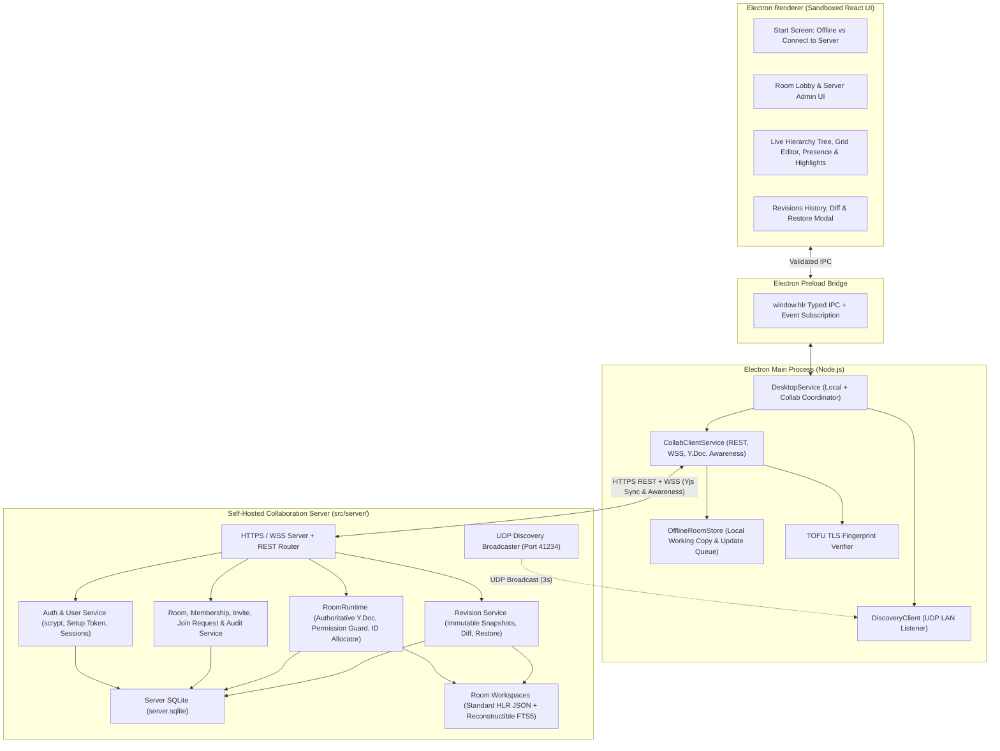

# Multi-User Collaboration Architecture

This document defines the architecture for transforming the HLR Writing Tool into a real-time, self-hosted, air-gapped multi-user collaboration system while preserving 100% of the existing single-user offline desktop functionality.

---

## 1. High-Level System Overview



---

## 2. New Dependencies & Air-Gapped Rationale

> [!WARNING]
> **Superseded by ARCHITECTURE-v2.md §7**: `yjs`, `y-protocols`, and `lib0` have been uninstalled and completely removed. Only `ws` (`^8.18.0`) and `@types/ws` are required for WebSocket communication.

To honor the strict air-gapped constraint (`BRIEF.md` §1.1), only **one pure-JavaScript runtime package** (plus one TypeScript types package) is added. It uses no native addons or post-install network scripts:

| Package | Role | Why Chosen & Offline Packaging |
|---|---|---|
| `ws` (`^8.18.0`) + `@types/ws` | WebSocket server & client over Node `http`/`https` | Fast, standard RFC 6455 implementation in pure JS (optional native peer dependencies `bufferutil` and `utf-8-validate` are omitted). |

All other capabilities use Node.js built-ins or existing vendored dependencies:
- **TLS Certificate Generation & Pinning**: `node:crypto` (`generateKeyPairSync`, `sign`, `X509Certificate`, `createHash`) with a pure-TypeScript ASN.1/DER self-signed X.509 v3 builder (`src/server/tls.ts`). Zero dependency on external `openssl` binaries.
- **Password Hashing & Tokens**: `node:crypto` (`scryptSync`, `randomBytes`, `timingSafeEqual`, `createHash`).
- **UDP LAN Discovery**: `node:dgram` IPv4 broadcast sockets.
- **Database**: Existing `better-sqlite3` (`12.8.0`).
- **Validation**: Existing `zod` (`3.24.2`).

---

## 3. Module Layout (Exact File Paths)

> [!IMPORTANT]
> Do **not** modify `src/shared/utils/idUtils.ts`, `src/main/services/idGenerator.ts`, `src/shared/types/schema.ts`, or `src/main/services/validation.ts` unless preserving 100% statement/branch/function/line coverage enforced by `vitest.config.ts`. Reuse them by importing into the new modules below.

```
hlr-writing-tool/
├── scripts/
│   └── run-server.mjs                         <-- Runs dist/server/index.js using Electron's Node ABI (ELECTRON_RUN_AS_NODE=1)
├── src/
│   ├── shared/
│   │   ├── api.ts                             <-- Extended with CollabState, CollabAPI IPC methods & channels
│   │   ├── appSettings.ts                     <-- Extended with rememberedServers (URL, name, pinnedFingerprint)
│   │   └── collab/
│   │       ├── types.ts                       <-- ServerRole, RoomRole, User, Room, CollabOp, LockState, Presence, etc.
│   │       ├── permissions.ts                 <-- Pure permission checks (canServerAction, canRoomAction, authorizeOp)
│   │       └── protocol.ts                    <-- Zod wire schemas for REST bodies, v2 WS messages, locks, presence, beacons
│   ├── server/
│   │   ├── index.ts                           <-- CLI entrypoint (`npm run server`, parses flags/env, prints setup token)
│   │   ├── db.ts                              <-- ServerDatabase (better-sqlite3 wrapper & schema for server.sqlite)
│   │   ├── tls.ts                             <-- Pure-TS ASN.1 DER X.509 self-signed cert generator & SHA-256 fingerprint helper
│   │   ├── auth.ts                            <-- AuthService (setup token, scrypt passwords, sessions, user admin)
│   │   ├── rooms.ts                           <-- RoomService (rooms, memberships, invites, invite codes, join requests, kick/ban, audit log)
│   │   ├── roomRuntime.ts                     <-- RoomRuntime (authoritative Y.Doc, permission diffing, server ID allocation, autosave)
│   │   ├── revisions.ts                       <-- RevisionService (save immutable snapshot, list, diff, restore as new revision)
│   │   ├── wsHandler.ts                       <-- WebSocket upgrade, auth handshake, Yjs sync/awareness routing, room notifications
│   │   ├── discovery.ts                       <-- DiscoveryBroadcaster (UDP beacon sender on port 41234)
│   │   └── httpServer.ts                      <-- CollabServer (HTTP/HTTPS REST router + WS server + lifecycle management)
│   ├── main/
│   │   ├── collab/
│   │   │   ├── tlsPinning.ts                  <-- TOFU certificate verification, fingerprint extraction & mismatch error handling
│   │   │   ├── discoveryClient.ts             <-- DiscoveryClient (UDP beacon listener & active server list)
│   │   │   ├── offlineStore.ts                <-- OfflineRoomStore (local disk cache of room workspace + queued Yjs updates)
│   │   │   └── collabClient.ts                <-- CollabClient (REST client, WS Yjs/Awareness client, reconnect & ID request queue)
│   │   ├── services/
│   │   │   └── desktopService.ts              <-- Extended to coordinate local mode vs connected server/room mode
│   │   ├── ipc/
│   │   │   └── registerHandlers.ts            <-- Extended with collaboration IPC channels and renderer push notifications
│   │   └── window.ts                          <-- Dynamic CSP & webRequest origin guard scoped to active user-chosen server
│   ├── preload/
│   │   ├── index.ts                           <-- Exposes collab IPC methods and onCollabEvent listener on window.hlr
│   │   └── api.d.ts
│   └── renderer/
│       ├── App.tsx                            <-- Mode routing (Local Workspace vs Server Connect vs Room Lobby vs In-Room Editor)
│       └── components/
│           ├── collab/
│           │   ├── ServerConnectView.tsx      <-- Discovered servers, manual host:port, TOFU warning modal, setup/login/register
│           │   ├── RoomLobbyView.tsx          <-- My rooms, listed rooms, invites, join requests, create/import room
│           │   ├── ServerAdminModal.tsx       <-- Server Owner/Admin user management, registration mode & all-rooms management
│           │   ├── RoomHeaderBar.tsx          <-- Connection status, autosave/revision badge, online member avatars, notifications
│           │   ├── RoomMembersModal.tsx       <-- Invite users/codes, approve join requests, change roles, kick/ban, transfer, audit
│           │   └── RevisionsModal.tsx         <-- Save revision, revision history, structured diff viewer, restore confirmation
│           ├── tree/
│           │   └── WorkspaceTree.tsx          <-- Extended with presence avatar pills on modules/functions and role-gated actions
│           └── editor/
│               ├── HierarchyView.tsx          <-- Extended with active viewers in header and role-gated Properties/Delete
│               ├── FunctionEditor.tsx         <-- Extended with live Y.Text scope editing, field highlights, soft locks, role gates
│               └── FieldEditor.tsx            <-- Extended with focus/blur awareness reporting and remote highlight badges
└── tests/
    └── unit/
        ├── collabPermissions.test.ts
        ├── collabProtocol.test.ts
        ├── yjsDoc.test.ts
        ├── serverAuth.test.ts
        ├── serverRooms.test.ts
        ├── roomRuntime.test.ts
        ├── serverRevisions.test.ts
        ├── discovery.test.ts
        ├── collabClient.test.ts
        ├── collabIpc.test.ts
        ├── serverConnectUi.test.ts
        ├── roomLobbyUi.test.ts
        ├── inRoomCollabUi.test.ts
        ├── offlineCollabBundle.test.ts
        └── collabE2E.test.ts
```

---

## 4. Reuse of Existing Domain Services on the Server

Because `src/main/services/*`, `src/main/config/projectConfig.ts`, and `src/main/db/sqliteClient.ts` have zero `electron` imports, the server imports and reuses them directly:

1. **Workspace Creation & Seeding**: `createWorkspace`, `addModule`, `addFunction` (`src/main/services/workspaceFactory.ts`) initialize new rooms when a room is created without an imported workspace.
2. **Human-Readable JSON Persistence**: `saveWorkspace` and `loadWorkspace` (`src/main/services/workspaceService.ts`) persist each room's working copy under `<dataDir>/rooms/<roomId>/workspace/` using the exact `.hlr/pending-save.json` crash-recovery journal and 2-space indented JSON layout (`project.config.json`, `retired-ids.json`, `requirements/`, `data-dictionary/`, `entities/`, `actions/`).
3. **Deterministic ID Allocation**: `addItem` and `deleteItem` (`src/main/services/idGenerator.ts`) and `formatId` (`src/shared/utils/idUtils.ts`) execute on the server inside `RoomRuntime` to allocate sequence numbers and formatted IDs atomically.
4. **Hierarchy & Authoring Transactions**: `changeHierarchy` (`src/main/services/hierarchyService.ts`), `editFunction` (`src/main/services/authoringService.ts`), and `updateProjectConfig` (`src/main/config/projectConfig.ts`) validate and apply structural mutations.
5. **Validation & Referential Integrity**: `validateWorkspace`, `validateValue`, `moduleChain` (`src/main/services/validation.ts`) and `validateReferences` (`src/shared/references.ts`) validate every room mutation and revision snapshot.
6. **Search & Export**: `WorkspaceIndex` (`src/main/db/sqliteClient.ts`) maintains `.hlr/cache.sqlite` inside each room's workspace folder, and `exportWorkspace` (`src/main/services/exportService.ts`) powers CSV and Markdown export for all room roles (including `VIEWER`).

**Native Binary ABI Compatibility (`scripts/run-server.mjs`)**:
In this repository, `better-sqlite3` is compiled against Electron's Node ABI (`npm run setup:desktop`). Just as `scripts/run-tests.mjs` spawns Electron with `ELECTRON_RUN_AS_NODE=1`, `scripts/run-server.mjs` spawns `electron dist/server/index.js` with `ELECTRON_RUN_AS_NODE=1` when the `electron` binary is present (and falls back to `process.execPath` if `HLR_USE_SYSTEM_NODE=1`). This ensures `npm run server`, `npm test`, and `npm start` share the exact same `better_sqlite3.node` binary without rebuilding.

---

## 5. Data Flow for a Live Edit

> [!WARNING]
> **Superseded by ARCHITECTURE-v2.md §2 & §4**: Yjs CRDT binary updates, character-level text merging, and scalar soft locks have been replaced by server-ordered granular operations (`CollabOp`) and 10s lease locks (`item:<id>`, `function:<id>:scope`). All edits are authorized by `authorizeOp`.

### 5.1 Text / Markdown Field Edit (`Y.Text` Character-Level Merge)
1. **Focus**: User A focuses the Function `description` textarea or a requirement's `col_desc` cell. The renderer notifies `window.hlr.collabFocusField({ functionId, itemId, columnId, cursor })`.
2. **Awareness Broadcast**: `CollabClient` updates its local `Awareness` state and sends a `ws` `awareness` frame to the server. The server broadcasts the frame to all room peers. User B's renderer immediately draws a colored border (`2px solid <UserA.color>`) and floating name tag (`User A`) around that field.
3. **Typing**: User A types characters. `CollabClient` runs `applyTextChange(ytext, nextString)` inside a `ydoc.transact()`, which computes the minimal prefix/suffix delta (`ytext.delete` / `ytext.insert`) and produces a compact binary `Uint8Array` Yjs update.
4. **Server Validation & Fan-out**:
   - Client sends `{ type: 'sync-update', update: base64(updateBytes) }`.
   - `RoomRuntime` verifies User A's role (`EDITOR`, `ROOM_ADMIN`, or `ROOM_OWNER`), applies `updateBytes` to a cloned staging `Y.Doc`, verifies via `validateYDocDiffPermissions` that no unauthorized structural or config changes occurred and that the workspace remains valid (`validateWorkspace`), and commits `updateBytes` to the authoritative `room.ydoc`.
   - `RoomRuntime` synchronously logs `updateBytes` into SQLite `yjs_updates`, broadcasts `{ type: 'sync-update', update }` to all connected room sockets, and schedules the debounced working-copy `saveWorkspace`.
5. **Peer Render**: User B's `CollabClient` applies `updateBytes` to its local `Y.Doc`, converts to `Workspace`, and pushes the updated state to User B's renderer. If User B is simultaneously typing in a different part of the same `Y.Text` field, Yjs merges both character streams without data loss.

### 5.2 Scalar Field Edit (Last-Writer-Wins + Soft Lock)
1. When User A focuses a scalar field (`number`, `date`, `boolean`, `enum`, `reference`), User B sees User A's highlight and name badge (`soft lock`).
2. If User B attempts to edit that same scalar field while User A holds focus, the UI shows a confirmation prompt (`"<User A> is currently editing this field. Overwrite their value?"`).
3. If confirmed (or when uncontested), updating the scalar value sets `valuesMap.set(columnId, newValue)` in `Y.Doc`, which propagates via `sync-update` as last-writer-wins.

### 5.3 Structural Hierarchy or Project Config Mutation
1. Creating/editing/deleting a module or function, or updating `ProjectConfig`, can be performed either via `Y.Doc` transaction or dedicated command message (`mutate-hierarchy` / `update-config`).
2. `RoomRuntime` checks role permissions (`EDITOR` can add/edit modules and functions; only `ROOM_ADMIN`/`ROOM_OWNER` can delete modules/functions or update `ProjectConfig`), validates with `changeHierarchy` / `updateProjectConfig` / `validateWorkspace`, updates the authoritative `Y.Doc`, and broadcasts the resulting Yjs update.

---

## 6. Server-Authoritative ID Allocation

> [!WARNING]
> **Superseded by ARCHITECTURE-v2.md §2**: Temporary pending IDs (`__pending__:<uuid>`) in Y.Doc are replaced by `item.create` operations. The server processes operations sequentially, atomically generates sequence numbers and IDs via `addItem` during serial execution, and returns the assigned ID in `op-ack` and `op-applied`.

To guarantee `Agents.md` §5 ID immutability under concurrency:
1. **Pending Row Creation**: When a user adds a row in a room, the client creates a local pending draft with a temporary ID (`__pending__:<uuid>`) and displays the next-ID preview. No permanent ID is consumed while the draft is incomplete.
2. **Allocation Request**: When the user commits the row (or via `alloc-item` WS message / syncing a `__pending__:<uuid>` item in `Y.Doc`), the client sends `{ type: 'alloc-item', requestId, tempId, objectType, functionId, values }`.
3. **Atomic Server Assignment**:
   - `RoomRuntime` processes allocation requests sequentially on the room's single-threaded mutation queue.
   - It invokes `addItem(workspace, objectType, functionId, values)` (`src/main/services/idGenerator.ts`), which increments `fn.watermarkCounter` monotonically and skips any ID already present in `domains` or `workspace.retiredIds`.
   - `RoomRuntime` inserts the permanent item (with its assigned `id` and `seq`) and the updated `watermarkCounter` into `room.ydoc` (removing any `__pending__:<tempId>` placeholder), persists the update to `yjs_updates`, broadcasts the Yjs update to all room peers, and replies `{ type: 'alloc-item-ack', requestId, tempId, item }`.
4. **Item / Subtree Deletion**: Deleting an item or module/function on the server appends all deleted item IDs to `room.ydoc.getArray('retiredIds')` and never decrements `watermarkCounter`.

---

## 7. Autosave and Revisions

### 7.1 Crash-Safe Continuous Autosave

> [!WARNING]
> **Superseded by ARCHITECTURE-v2.md §6 & §7**: The `yjs_updates` table has been replaced by `room_ops` (`seq`, `room_id`, `op_id`, `actor_id`, `op_kind`, `op_payload`, `created_at`) and `rooms.materialized_seq`. Autosave debounces saving `Workspace` to disk and updates `materialized_seq`. Crash recovery replays any unmaterialized ops (`seq > materialized_seq`) on top of the saved working copy.

- **Write-Ahead Yjs Log**: Every accepted Yjs update is synchronously written to the `yjs_updates` table in `server.sqlite` (`id INTEGER PRIMARY KEY AUTOINCREMENT, room_id TEXT, update_blob BLOB, created_at TEXT`).
- **Debounced JSON Materialization**: After `500ms` of inactivity (or max `2000ms` under continuous typing, and immediately on room close / server shutdown), `RoomRuntime` calls `saveWorkspace(roomWorkspaceDir, yDocToWorkspace(room.ydoc))` and rebuilds `.hlr/cache.sqlite`.
- **Compaction**: Once `saveWorkspace` completes, `RoomRuntime` replaces the room's incremental rows in `yjs_updates` with a single compacted `Y.encodeStateAsUpdate(room.ydoc)` row, updates `rooms.last_autosaved_at`, and broadcasts `{ type: 'autosave-status', status: 'autosaved', autosavedAt }` to all clients.
- **Crash Recovery**: On server startup, `RoomRuntime` calls `loadWorkspace(roomWorkspaceDir)` (replaying `.hlr/pending-save.json` if interrupted), converts it via `workspaceToYDoc`, and applies all rows in `yjs_updates` for that room.

### 7.2 Admin Revisions (Save, History, Diff, Restore)
- **Save Revision (`ROOM_OWNER` / `ROOM_ADMIN`)**: Flushes the working copy immediately, assigns the next monotonic revision `seq` for the room, writes the complete validated `Workspace` JSON to `<dataDir>/rooms/<roomId>/revisions/rev_<id>.json`, inserts metadata into `revisions`, logs an audit entry, and broadcasts `{ type: 'revision-saved', revision }`.
- **Diff**: Compares any revision snapshot against the current working copy (or another revision) and returns added/modified/deleted modules, functions, and items (with changed column names) plus config change flags.
- **Restore (`ROOM_OWNER` / `ROOM_ADMIN`)**:
  - Reads the target revision's `Workspace` JSON.
  - **ID Safety Rule**: Raises each function's `watermarkCounter` to `Math.max(currentFn.watermarkCounter, targetFn.watermarkCounter)` and merges `retiredIds = Array.from(new Set([...current.retiredIds, ...target.retiredIds, ...allCurrentItemIds]))` (excluding items present in the restored snapshot, while keeping any item ID that was ever deleted or existed only in newer history retired!). This guarantees restoring an old revision can **never** cause a future `addItem` to reuse an ID that was issued after that revision.
  - Replaces `room.ydoc` state, saves the working copy, creates a **new immutable revision** (`"Restored from revision #<seq>: <message>"`), logs an audit entry, and broadcasts the new state and revision to all room clients.

---

## 8. Offline Mode, Reconnect, and Conflict Resolution

> [!WARNING]
> **Superseded by ARCHITECTURE-v2.md §2 & §3**: Yjs state vector exchange (`sync-step1`/`sync-step2`) has been replaced by sequence-number-based catch-up (`ops-since` request and `ops-since-reply`). If the client's disconnect gap exceeds retained ops, a full `snapshot` is transferred.

1. **Pure Offline Mode (No Server)**: Selecting **Work offline** uses `DesktopService`'s existing local filesystem and SQLite workflow with zero behavioral changes.
2. **Temporary Disconnect in a Room**:
   - `CollabClient` tracks connection state: `'connected' | 'reconnecting' | 'offline'`.
   - When the WebSocket drops, `CollabClient` switches to `'reconnecting'`, persists the current `Workspace` + encoded `Y.Doc` state + pending local Yjs updates and pending `alloc-item` requests into `OfflineRoomStore` (`<userData>/collab-cache/<serverId>/<roomId>/`), and allows the user to keep editing locally.
   - `CollabClient` attempts exponential-backoff reconnection (`500ms`, `1s`, `2s`, `5s`).
3. **Sync on Reconnect**:
   - Upon reconnecting and authenticating, client and server exchange Yjs `sync-step1` / `sync-step2` state vectors, followed by any queued offline updates and pending item allocations.
4. **Permission Loss While Offline**:
   - If the user was demoted to `VIEWER`, kicked, or banned while offline, the server rejects the replayed updates with `{ type: 'error', code: 'PERMISSION_REVOKED', message: '...' }` and sends the authoritative `sync-step2` snapshot. `CollabClient` discards its rejected offline delta, resets its local `Y.Doc` to the server snapshot, and surfaces a prominent alert explaining that permissions changed while offline.
5. **Deterministic Structural Conflict Resolution**:
   - If User A edits an item or function while offline (or concurrently) inside a module or function that User B (an Admin) deleted, `RoomRuntime` detects that the target function/module no longer exists in the authoritative `Y.Doc`.
   - Deletion wins deterministically: `RoomRuntime` drops the orphaned mutation, preserves the deletion and retired IDs, resynchronizes User A's `Y.Doc` to the authoritative state, and emits `{ type: 'conflict', code: 'TARGET_DELETED', targetId, message: 'The module or function you were editing was deleted by an administrator.' }`, which the UI displays as a clear conflict notice.


---

## 9. Security Architecture

### 9.1 HTTPS/WSS & Trust-On-First-Use (TOFU) Fingerprint Pinning
- By default, the server starts with HTTPS and WSS using the self-signed certificate in `<dataDir>/tls/cert.pem`. Plain HTTP/WS is permitted only when `--insecure-http` is explicitly passed (e.g., for local testing).
- When `CollabClient` connects over HTTPS/WSS (`src/main/collab/tlsPinning.ts`):
  - It reads the server's DER certificate from the TLS socket (`socket.getPeerCertificate(true).raw`) and computes `SHA256:<hex-colon-separated>`.
  - If no fingerprint is pinned yet for that server URL in `AppSettings.rememberedServers`, it pins the fingerprint (TOFU) and persists it.
  - If a fingerprint is already pinned and matches, the connection proceeds.
  - If the certificate fingerprint differs from the pinned fingerprint, `CollabClient` immediately aborts the connection and returns `TLS_FINGERPRINT_MISMATCH` with both fingerprints. The UI displays a security warning modal requiring explicit user confirmation before updating the pin.

### 9.2 Renderer Sandbox, Dynamic CSP, and Network Guard
- The Electron renderer keeps `contextIsolation: true`, `sandbox: true`, `nodeIntegration: false`, and `webSecurity: true`.
- All network sockets (`node:https`, `ws`, `node:dgram`) run in the **Main process** (`src/main/collab/`).
- In `src/main/window.ts`, `setAllowedServerOrigin(origin: string | null)` controls network policy:
  - When working offline (`origin === null`), `onBeforeRequest` cancels every request except `file:` and `devtools:`, and `index.html` enforces `connect-src 'none'`.
  - When connected to a user-chosen server `origin` (e.g., `https://192.168.1.50:8443`), `onBeforeRequest` permits only `file:`, `devtools:`, and URLs matching that exact host/port (`https://192.168.1.50:8443/*`, `wss://192.168.1.50:8443/*`), and `onHeadersReceived` scopes `connect-src 'self' https://192.168.1.50:8443 wss://192.168.1.50:8443`. All other external URLsremain strictly blocked.

### 9.3 Validated IPC Changes
- `src/main/ipc/registerHandlers.ts` validates the sender frame (`event.sender === window.webContents && event.senderFrame === window.webContents.mainFrame && event.senderFrame.url === rendererUrl`) and validates every collaboration payload with Zod schemas from `src/shared/collab/protocol.ts`.
- Main-to-renderer push notifications use a single typed channel `'hlr:collab-event'` subscribed via `contextBridge` (`window.hlr.onCollabEvent(callback)`).

---

## 10. Offline Packaging of New Dependencies

1. **Connected Preparation (`offline/download-deps.sh` & `package.json`)**:
   - `yjs`, `y-protocols`, `lib0`, `ws`, and `@types/ws` are pinned in `package.json` and `package-lock.json` and cached in `offline/cache/npm`.
2. **Offline Bundle Assembly (`offline/bundle.mjs` & `offline/seal.mjs`)**:
   - Copy `docs` (including `docs/collab/`) alongside `src`, `tests`, `scripts`, `build`, `Dockerfile`, and config files into `offline/staging/hlr-dev-<platform>-x64`.
   - Because `yjs`, `y-protocols`, `lib0`, and `ws` are pure JS, `npm ci --ignore-scripts --cache offline/cache/npm` installs them cleanly for both `linux-x64` and `win32-x64` without any native compilation step.
3. **Standalone Server & Container Execution**:
   - `npm run build` compiles `src/server/**/*.ts` to `dist/server/**/*.js`.
   - `npm run server` starts the collaboration server headlessly on any air-gapped machine using the bundled runtime and `better-sqlite3` native binding.
   - `Dockerfile` exposes port `8443` (TCP HTTPS/WSS) and `41234/udp` (discovery) and can run either the packaging pipeline or `npm run server`.
